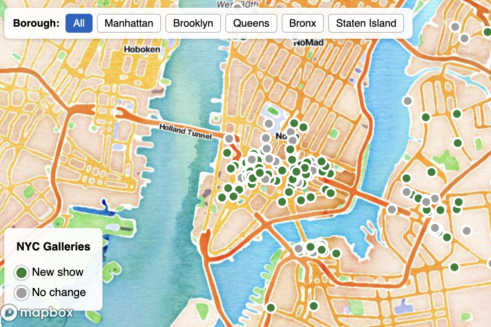

# NYC Gallery Tracker

**Live site: [nycgallerytracker.com](https://nycgallerytracker.com/)**

A free, interactive map of New York City's art galleries — about 235 of them across
all five boroughs — that checks every gallery's website each day and flags the ones
that have posted something new. Open it to see what's on near you, plan a gallery
walk, or get a weekly email of new shows.



## What it does

- **Interactive map** of galleries in Chelsea, the Lower East Side, Tribeca, SoHo,
  Bushwick, Williamsburg, DUMBO and beyond, with a filterable directory underneath.
- **Daily change detection.** A scraper visits every gallery's homepage and records
  when its content actually changes, so "new" means a new show or announcement, not
  a rotated banner.
- **Weekly "new shows" digest**, published as a permanent page under
  [`/new-shows/`](https://nycgallerytracker.com/new-shows/) and sent by email to
  subscribers every Monday.
- **Neighborhood and borough pages** (`/galleries/`) and **walking routes**
  (`/routes/`) for planning an afternoon of gallery-hopping.
- **Installable** as a phone app (PWA), with optional notifications.

## How it works

Everything runs on a schedule in GitHub Actions and is served as static files by
Netlify. There is no server or database — the data lives in this repo.

```
GitHub Actions (daily, 12:00 UTC)
  scraper.py        → checks every gallery site, records which ones changed
  validate_data.py  → stops the build if any data looks wrong
  build_site.py     → regenerates every page and sitemap.xml
  commit + push     → Netlify deploys the update automatically
  (Mondays) render_weekly_digest.py → emails the weekly digest
```

If validation fails, the site keeps the previous day's data rather than
publishing bad data.

### Key files

| File | Purpose |
|---|---|
| `index.html` | The homepage: map, directory, sign-up |
| `data/galleries.json` | The gallery dataset (GeoJSON) plus change-tracking state |
| `scraper.py` | Daily change detection across all gallery sites |
| `validate_data.py` | Sanity checks (e.g. coordinates that don't match the address) |
| `build_site.py` | Runs all the page generators in the right order |
| `render_*.py` | Page generators: gallery cards, area pages, guides, routes, digests |
| `site_common.py` | Shared header, footer, styles and analytics for generated pages |
| `build_gallery_list.py`, `fetch_google_places.py` | One-off tools used to build the gallery list |
| `.github/workflows/` | Scheduled scrape/build and manual digest send |

## Running it locally

Requires Python 3.11.

```bash
pip install -r requirements.txt
python scraper.py        # optional — hits every gallery website
python validate_data.py
python build_site.py
python -m http.server 8000   # then open http://localhost:8000
```

The one-off data tools need API keys in environment variables
(`MAPBOX_TOKEN`, `GOOGLE_PLACES_KEY`); sending the digest needs
`BUTTONDOWN_API_KEY`. None of these are needed to build or view the site.

## Built with

Python (requests, BeautifulSoup, pandas) · Mapbox GL JS · GitHub Actions ·
Netlify · Buttondown

## Corrections

Gallery missing, closed, or in the wrong place? Please
[open an issue](https://github.com/JF11579/NYC-Gallery-App/issues).
